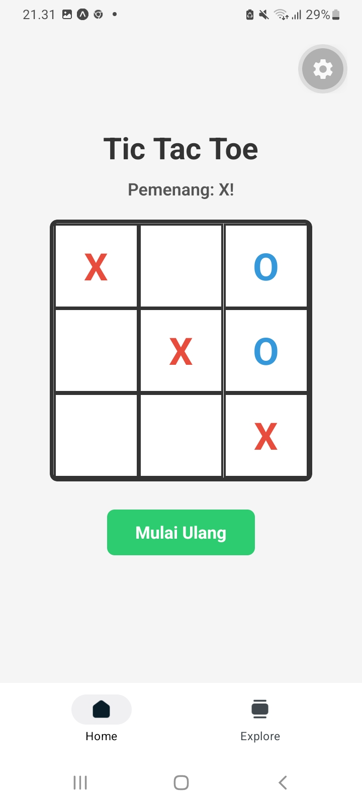

# Tic Tac Toe App

Aplikasi permainan Tic Tac Toe (XO) untuk dua pemain yang dibuat menggunakan React Native dan Expo. Proyek ini dibuat sebagai tugas Sesi #5 mata kuliah Pemrograman Mobile untuk belajar konsep dasar React Native seperti state management, event handling, dan tata letak dengan Flexbox.

## Tampilan Aplikasi



## Fitur Utama

- Papan permainan 3x3 yang bisa ditekan
- Giliran pemain X dan O bergantian secara otomatis
- Deteksi pemenang (baris, kolom, dan diagonal)
- Deteksi permainan seri jika semua kotak terisi
- Status permainan yang berubah otomatis (giliran pemain, pemenang, atau seri)
- Tombol "Mulai Ulang" untuk mengulang permainan dari awal
- Simbol X berwarna merah dan O berwarna biru supaya mudah dibedakan

## Teknologi yang Digunakan

- React Native
- Expo (dengan Expo Router)
- TypeScript
- Node.js dan npm

## Cara Instalasi dan Menjalankan

1. Pastikan Node.js sudah terpasang, cek dengan:

   ```bash
   node -v
   npm -v
   ```

2. Clone repositori ini:

   ```bash
   git clone https://github.com/fasha09/TicTacToeApp.git
   cd TicTacToeApp
   ```

3. Install dependencies:

   ```bash
   npm install
   ```

4. Jalankan aplikasi:

   ```bash
   npx expo start
   ```

5. Install aplikasi **Expo Go** di HP (Play Store / App Store), lalu scan QR Code yang muncul di terminal. Aplikasi akan terbuka dan bisa langsung dimainkan.

## Struktur Singkat

Kode utama permainan ada di `src/app/index.tsx`.

## Konsep yang Dipelajari

- `useState` untuk menyimpan kondisi papan dan giliran pemain
- Immutability, yaitu membuat salinan array dengan spread operator (`[...board]`) sebelum diubah
- Flexbox untuk menyusun papan 3x3
- Event handling lewat `TouchableOpacity`

## Lisensi

Proyek ini menggunakan lisensi MIT.

## Kontak

- GitHub: [fasha09](https://github.com/fasha09)
